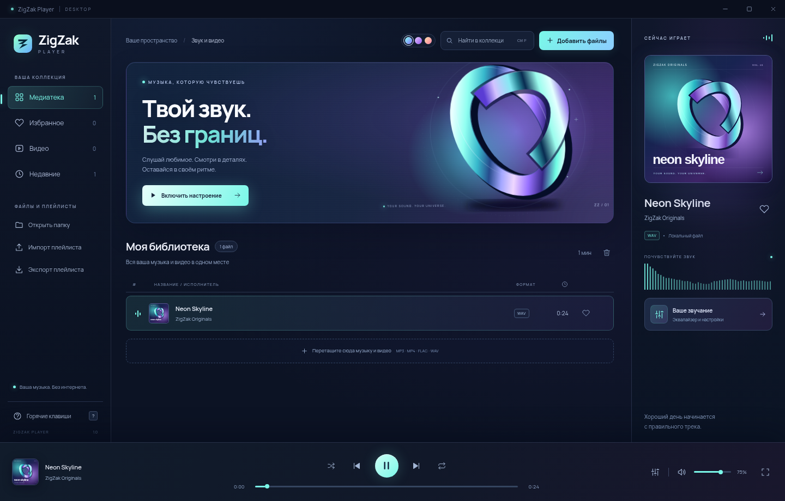

# ZigZak Player

Красивый переносимый MP3/MP4 плеер для Windows 10/11 x64.

**[Скачать ZigZak Player.exe](https://github.com/asmdawk/mpo/releases/download/zigzak-v1.0.0/ZigZak-Player-1.0.0-Windows-x64.exe)** · [Все файлы релиза](https://github.com/asmdawk/mpo/releases/tag/zigzak-v1.0.0)



Три темы оформления, эквалайзер на 10 полос, плейлисты, избранное, поиск, полноэкранное видео, скорость и таймер сна. Без установки и регистрации.

## Разработка

Требуется Node.js 22+.

```sh
npm ci
npm test
npm start
npm run build:win
```

Готовый переносимый файл появляется в `dist/`. Сборка не подписана цифровым сертификатом. [Русская инструкция](README-RU.md).
